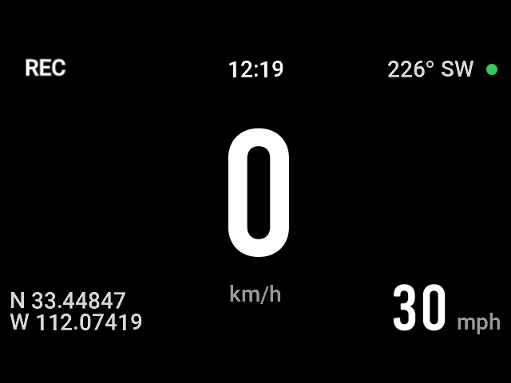

# 70mai A810Pro：开 Telnet、改隐藏设置、增强屏保

[English](README.md)

国行 A810Pro 的硬件和固件其实支持英文菜单、mph、其他日期格式和国外时区，只是没有在菜单里开放。本仓库先获取记录仪的 telnet root 权限，再通过修改配置，恢复多语言菜单，时区等配置。

1. **开启 Telnet**：在工厂模式下通过 USB 装一次即可。
2. **修改设置**：通过记录仪 Wi-Fi 改界面语言、速度单位、日期格式、时区和夏令时。
3. **屏保叠加（可选）**：在时速屏保上加显示时间、航向、GPS 坐标和 mph。

> [!IMPORTANT]
> 只在 **70mai A810Pro（型号 DR2830）国行固件 1.2.42** 上测试过。每个工具都会先检查型号和固件，不匹配就停止。

需要一台 Mac、Python 3.10 或更新版本，以及一根能传数据的 USB 线。不需要用 pip 装任何东西。

开始前请注意：

- 进入工厂模式需要**恢复出厂设置**，现有设置会被清空，需要的话先记下来。
- Telnet 开启后，连上记录仪 Wi-Fi 的人都能**无密码**拿到 root shell。请保管好 Wi-Fi 密码，不用时关掉 Wi-Fi。
- 改装风险自负。

| 目录 | 内容 |
|---|---|
| [`telnet/`](telnet) | `macos.py`：通过 USB 串口安装 Telnet |
| [`settings/`](settings) | `70mai-settings`：通过 Telnet 读取和修改设置 |
| [`ssoverlay/`](ssoverlay) | `deploy.py` 和编译好的屏保叠加程序 `ssoverlay` |

下面所有命令都在仓库根目录执行。

---

## 第一部分：开启 Telnet

### 1.1 进入工厂模式

先用普通电源（车充或 USB 充电头，不要用电脑）给记录仪供电。

1. 在记录仪设置里选“恢复出厂设置”，等它重启。
2. 停在**第一张欢迎页（页面上只有一个70mai的logo，和右下角的一个✅）**，不要继续进入时间设置。
3. 面对屏幕，四颗按钮从左到右是 `1  [2]  3  4`。把**第 2 颗**短按五次，每次间隔约 0.3–0.5 秒（每次按下去可以听到按键音），不要超过 1 秒。
4. 记录仪会自动重启，进入工厂（工程）界面。

只有第一张欢迎页能用这个按法，时间设置页和其他页面都不行。如果已经点过欢迎页，就再恢复一次出厂。

### 1.2 在 Mac 上安装

停在工厂界面时，用 USB 线把记录仪接到 Mac，执行：

```sh
python3 telnet/macos.py ports
python3 telnet/macos.py check
python3 telnet/macos.py install
```

- `ports` 列出能看到的串口。
- `check` 只读不写，显示型号、固件以及是否已经安装。
- `install` 再检查一遍，先备份，再装入两个小脚本并校验。

如果只有一个 `/dev/cu.usbmodem…` 串口会自动选中；有多个时需要指定：

```sh
python3 telnet/macos.py --port /dev/cu.usbmodem1101 install
```

完成后会显示 Mac 和记录仪上的备份路径，最后是 `Installed and verified.`。重复执行 `install` 只会提示已经装好。

### 1.3 回到正常模式并测试

1. 在工厂菜单里选“恢复出厂”（在菜单的最底下），记录仪会重启。
2. 拔掉 Mac 的 USB 线，接普通电源，正常走完欢迎页和时间设置。
3. 打开记录仪 Wi-Fi，让 Mac 连上。
4. Telnet 连接 `192.168.0.1`，用户名 `root`，无密码：

   ```sh
   telnet 192.168.0.1
   ```

   执行 `id`，应该显示 `uid=0(root)`。输入 `exit` 退出。

macOS 已经不自带 `telnet` 命令。可以 `brew install telnet`，也可以直接进入第二部分：`./settings/70mai-settings show` 会自己登录，本身就能当测试用。

此后每次打开记录仪 Wi-Fi 都会自动启动 Telnet，重启后也一样，不需要再进工厂模式。

### 关闭 Telnet

以下命令在 **Telnet 登录到记录仪后**执行，不是在 Mac 上。

不再自动启动：

```sh
touch /usr/bin/70mai-telnet.disabled
sync
```

恢复自动启动：

```sh
rm -f /usr/bin/70mai-telnet.disabled
sync
```

两者都在下次打开 Wi-Fi 时生效。已经在运行的 Telnet 会一直开着，直到记录仪重启。

### 卸载

在工厂模式下（和安装时一样连 USB）：

```sh
python3 telnet/macos.py uninstall
```

它会先备份，并且只删除和自己装的内容完全一致的文件。

不想进工厂模式的话，可以在记录仪的 Telnet 里先确认文件是本工具装的：

```sh
md5sum /usr/bin/hostapd /usr/bin/70mai-telnet-start
```

只有结果分别是 `551795c98df05487a9e6349d78f64e6c` 和 `d31f9adc33086436184fe58895e5f7c7` 时，才删除它们（如果建过 `.disabled` 文件也一起删）：

```sh
rm /usr/bin/hostapd /usr/bin/70mai-telnet-start
sync
```

当前会话在重启前还能用。重启后 Telnet 就没了，要用的话需要重新安装。

### 其他型号或固件

在子命令前加 `--skip-version-check`，会跳过型号、版本和原厂文件 MD5 的检查：

```sh
python3 telnet/macos.py --skip-version-check check
python3 telnet/macos.py --skip-version-check install
```

它仍会检查这个方法依赖的布局：串口是 root shell；`/usr/bin` 是可写、断电保留的 UBIFS；原厂 `hostapd`、`telnetd` 在预期位置；`main_app` 的 `PATH` 里 `/usr/bin` 排在 `/mnt/app/bin` 前面；Wi-Fi 脚本按名字调用 `hostapd`。任何一项不符都会停止。

这条路没有实测过，工厂模式的按键入口也只在 DR2830 国行 1.2.42 上确认过。这个选项只对 Telnet 安装器有效；第二、三部分依赖该固件特有的内存地址，在其他固件上会拒绝运行。

### 常见问题

| 现象 | 处理方法 |
|---|---|
| 按五次没反应 | 确认停在第一张欢迎页，按的是左数第二颗；短按，间隔不超过 1 秒 |
| Mac 只看到 U 盘，没有串口 | 记录仪没进工厂模式；正常模式下接电脑会进入文件传输 |
| 没有 `/dev/cu.usbmodem…` | 确认线能传数据，换个接口，确认屏幕上是工厂界面。不需要装驱动 |
| 有多个串口 | 用 `--port` 指定，或拔掉其他 USB 串口设备 |
| 提示固件或文件不匹配 | 固件不是测试过的版本，见“其他型号或固件” |
| 加了 `--skip-version-check` 仍提示布局不符 | 这个方法不适用于该固件 |
| 已有同名文件 | 可能是其他改装留下的。安装器不会覆盖，请先查明来源 |
| 超时或校验失败 | 保留它显示的备份目录。重新连接，先运行 `check` 再做别的 |
| 提示锁可能还在记录仪上 | 确认没有另一个安装器在运行，然后重启记录仪。锁在 `/tmp`，重启即消失 |
| Telnet 连不上 | 记录仪要正常开机并打开 Wi-Fi，Mac 要连在记录仪的网络上；确认没有建 `.disabled` 文件 |

---

## 第二部分：语言、单位、日期和时区

连上记录仪 Wi-Fi，然后：

```sh
./settings/70mai-settings show       # 当前设置
./settings/70mai-settings options    # 所有可选值
```

这个包装脚本只是执行 `python3 settings/mai_settings.py`。`--host` 这类全局选项放在子命令前面。

### 常用修改

先预览，`--dry-run` 只显示修改前后，不做任何改动：

```sh
./settings/70mai-settings set --language en --units mph --date-order mdy --dry-run
```

确认后执行：

```sh
./settings/70mai-settings set --language en --units mph --date-order mdy
```

| 选项 | 取值 |
|---|---|
| `--language` | `en`、`zh-CN` |
| `--units` | `kmh`、`mph` |
| `--date-order` | `ymd`（2026/10/12）、`mdy`（10/12/2026）、`dmy`（12/10/2026） |
| `--utc-offset` | 标准时间的 UTC 偏移，如 `--utc-offset=-07:00`、`--utc-offset=+05:45` |
| `--dst` | `on` 或 `off` |
| `--reboot` | 完成后重启 |

退出再进入菜单或屏保就能看到新值。录像水印要重启后才会用上新的单位和日期格式，可以加 `--reboot` 或手动断电重启。重启后需要重新连 Wi-Fi。

### 时区和夏令时

国行固件有时区设置，但没有夏令时开关。本工具开启夏令时的做法是改用快一小时的时区，并在记录仪上记下你的标准偏移，这样来回切换很简单：

```sh
# 第一次：给出标准时间偏移（美国山地时间是 -07:00）
./settings/70mai-settings set --utc-offset=-07:00 --dst off

# 以后换季时：
./settings/70mai-settings set --dst on     # 记录仪改用 UTC-6
./settings/70mai-settings set --dst off    # 回到 UTC-7
```

- 连续执行两次 `--dst on` 不会加两小时。
- 不会自动切换，春秋两季需要自己执行。
- 第一次使用，或时区被其他方式改过后，需要带上 `--utc-offset`。`show` 里 `"manual_dst": null` 表示工具不知道你的标准偏移，不代表夏令时关闭。
- **不能用 UTC+6。** 国行固件会把这一项当成 UTC+8，所以最终落在 UTC+6 的组合会被拒绝。+05:30、+05:45 这类半小时、一刻钟偏移可以用。
- 这里改的是记录仪用 GPS 校时使用的偏移。如果你关了 GPS 自动校时，它不会帮你打开。

### 备份和还原

每次 `set` 或 `restore` 之前都会自动备份到 `~/.local/state/70mai-settings/backups/`（或 `--backup-dir` 指定的、尚不存在的目录）。也可以手动备份：

```sh
./settings/70mai-settings backup ./my-camera-backup
./settings/70mai-settings restore ./my-camera-backup --dry-run
./settings/70mai-settings restore ./my-camera-backup
```

`restore` 只还原本工具管理的内容（时区、单位、日期格式、菜单语言），之后改过的录像画质、音量等不受影响。备份里有记录仪的配置，请留在自己电脑上。

恢复国行默认：

```sh
./settings/70mai-settings set --language zh-CN --units kmh --date-order ymd
```

### 英文菜单是怎么实现的

只改固件的语言参数没用，国行固件开机时会强制使用中文。不过固件里带着英文文字，所以本工具在内存中把菜单文字表指向英文那一份。

每次开机都要重新做这一步，所以选英文时会安装一个小脚本 `/usr/bin/70mai-settings-ui`，并在 `/usr/bin/swapon` 中加一段带标记的启动调用（`/usr/bin` 重启后保留，`/etc` 不保留）。开机时脚本等 `main_app` 启动，核对 MD5，替换指针后退出。日志在 `/tmp/70mai-settings-ui.log`。

选 `zh-CN` 会删掉脚本和那段标记，并恢复指针。语音提示和声控不受影响。

如果只有 `main_app` 重启而整机没有重启，需要再执行一次 `set --language en`。

### 实机验证情况

已确认：英文菜单及开机自动生效、屏保显示 mph、屏保上的GPS信息，kmh/mph转换，画面显示月/日/年、设置重启后保留、备份与还原、夏令时开启/重复开启/关闭。

---

## 第三部分（可选）：屏保叠加



`ssoverlay` 在时速屏保上增加：

- 顶部中间：时间
- 右上：航向和 GPS 状态点（有定位为绿色，无定位为灰色）
- 左下：纬度、经度
- 右下：mph 车速

它只在**时速屏保**显示时绘制，请在记录仪设置里选用这个屏保。它不写 `main_app` 的内存和设置，只覆盖纯黑或自己画过的像素；遇到弹窗就跳过这一帧。启动时会核对 `main_app` 的 MD5 以及它依赖的 46 处代码，不一致就退出。

### 不安装先试用

程序只复制到 `/tmp`，重启就没了：

```sh
python3 ssoverlay/deploy.py upload
python3 ssoverlay/deploy.py start          # 实时 GPS 数据
python3 ssoverlay/deploy.py start fake     # 演示数据，室内也能看效果
python3 ssoverlay/deploy.py snap shot.png  # 截取记录仪屏幕
python3 ssoverlay/deploy.py stop
```

### 安装

```sh
python3 ssoverlay/deploy.py install
```

会新增 `/usr/bin/ssoverlay`、`/usr/bin/ssoverlay-start` 和 `/usr/bin/swapon` 启动钩子。每次开机，`main_app` 启动约 20 秒后开始显示。

`/usr/bin/swapon` 和第二部分的英文菜单共用，第二、三部分先做哪个都行，双方会保留对方的内容。如果 `/usr/bin/swapon` 里有其他来源的内容，安装会停止，不会动它。

日志：`/tmp/ssoverlay.log`，以及 SD 卡根目录的 `ssoverlay.log`（超过 1 MB 会轮换）。

### 停用或卸载

- 停用：在 SD 卡根目录放一个名为 `ssoverlay.off` 的空文件，或在记录仪上执行 `touch /usr/bin/ssoverlay.disabled`。下次开机生效。
- 立即停止：`python3 ssoverlay/deploy.py stop`
- 卸载：`python3 ssoverlay/deploy.py uninstall`（如果装了英文菜单，会保留它的启动段）

### 局限

- 目前是原型。车速固定用 mph 显示；没有定位时左下角显示中文“无定位”。
- 实机验证过：实时 GPS 数据、开机自启、与英文菜单共存。**先装英文菜单再装屏保**会走 `deploy.py` 中新写的逻辑：生成的 `swapon` 与实机验证过的文件逐字节相同，但这条路径本身只经过单元测试。

### 从源码编译

仓库里带有编译好的 `ssoverlay`（MD5 `620cef7e7313144f02a6747abfb5a405`），一般不需要自己编译。如需重新编译，要装 Homebrew 的 `llvm` 和 `lld`，还需要自己从记录仪取一份 `main_app`（例如 `/proc/<pid>/exe`），字体和代码指纹都从它提取。`main_app` 是 70mai 的代码，不包含在本仓库中。

```sh
MAIN_APP_ELF=/path/to/main_app ./ssoverlay/build.sh
```

---

## Telnet 的安装原理

安装器新增两个脚本，不改任何原厂文件：

- `/usr/bin/hostapd`：包装脚本。`main_app` 的 `PATH` 中 `/usr/bin` 排在前面，所以会先找到它而不是原厂的 `/mnt/app/bin/hostapd`。Wi-Fi 启动时，它在后台运行 `70mai-telnet-start`，再带着原参数转交给原厂 `hostapd`。
- `/usr/bin/70mai-telnet-start`：等 Wi-Fi 地址出现后，用原厂 `telnetd` 和 `/bin/login` 在 `192.168.0.1:23` 上启动 Telnet。

`/usr/bin` 在断电保留的闪存上；新增到 `/etc/init.d` 的文件重启就会消失，所以改为挂在 Wi-Fi 启动流程上。所有操作都是通过工厂串口 shell 写普通文件，不直接写闪存分区，也不碰 `main_app`、启动脚本或出厂数据。

备份：

- Mac 上：`~/.local/state/70mai-telnet/backups/`（或 `--backup-dir`），附带记录操作的 `manifest.json`。
- 记录仪上：`/mnt/other/70mai-telnet-backup-…/`，包括原厂 `hostapd`（`vendor-hostapd`）、相关启动脚本，以及之前已有的包装脚本（`previous-hostapd`）。卸载不会删除这些备份。

手动操作流程和两个安装脚本已在实机上验证：进入工厂模式、串口安装、回到正常模式后 Telnet 登录、重启后 Telnet 仍可用。把这些步骤自动化的 `macos.py` 目前只在 Mac 上对模拟串口做过测试。固件升级后是否保留没有测试，升级可能会删除这些文件。

## 运行测试

```sh
python3 -m unittest discover -s telnet/tests -v
python3 -m unittest discover -s settings/tests -v
python3 -m unittest discover -s ssoverlay/tests -v
```

有两个 Telnet 测试要和实机抓取的文件比对，需要把 `MAI_CAPTURES` 指向那些文件，否则会跳过。
