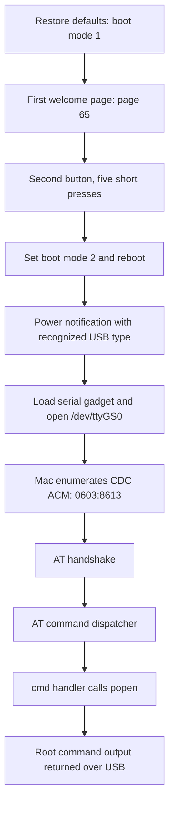

# Finding the factory-mode entry and USB serial command interface

This note explains how we found and verified the factory-mode entry on a
**70mai A810Pro / DR2830 running China-market firmware 1.2.42** on October 12,
2026. It focuses on the reasoning behind the discovery. For the steps to enable
Telnet, see [Part 1 of the README](../README.md#part-1-enable-telnet).

The result was a complete path from a hidden welcome-screen gesture to root
command execution over USB. We independently located this path in the device's
firmware and verified it on the owner's camera. This is not a claim that no one
had discovered it before.

## 1. Start with the firmware actually running on the camera

Earlier firmware unpacking work gave us useful search terms and a comparison
image from another 70mai model. It could not establish how this A810Pro behaved:
similar-looking startup scripts can enable different services.

The initial network checks reached HTTP and RTSP, but did not reach Telnet or
SSH. Reading the actual startup scripts gave a more useful explanation than a
port timeout alone. The A810Pro still contained the BusyBox `telnetd` program,
but its `S25_Net` script omitted the Telnet startup line found in the comparison
A810 firmware. We therefore needed a way to execute a command before we could
start the existing server.

The camera's HTTP service allowed reads of known system-file paths even though
directory listing was disabled. One such path, `/proc/self/exe`, returned the
ELF executable serving the request. Its size, project strings and startup
scripts associated it with `main_app`, the camera's main application. We used
that captured executable for the analysis rather than assuming the comparison
firmware was interchangeable.

| Property | Captured executable |
|---|---|
| Format | ELF32, little-endian ARM EABI5 |
| Size | 27,359,840 bytes |
| SHA-256 | `6440eb6792a96f4d1f556ecbd2ba2dc3f27c7d6b9fd70237f8064176aee69361` |

The binary is not distributed in this repository. All addresses below are
**ELF virtual addresses in this particular capture**, not file offsets or
addresses to reuse on another firmware version. Function names come from
retained strings, imported functions, or names assigned during analysis;
pseudocode is reconstructed from disassembly, not original source code.

## 2. Find a command handler, then prove what it does

Strings related to factory commands, `/dev/ttyGS0` and `g_serial` suggested a
USB diagnostic interface. Strings alone were only leads: they could describe
unused code or commands with empty implementations.

We located a factory command table whose entries contained a 64-byte command
field followed by a 4-byte handler address. One entry was especially useful:

```text
AT^cmd^  ->  handler at 0x825c0
```

The handler advanced the input pointer by seven bytes, skipping `AT^cmd^`, and
passed the remaining text to a helper at `0x82240`. That helper called
`popen(command, "r")`, collected output with `fgets()`, and called `pclose()`.
The handler then wrote the collected output back to its communication file
descriptor.

This established a shell-command execution path with a response channel. It
did **not yet** establish that we could reach it, or which privileges the
command would have at runtime. The next question was where that descriptor
came from.

Two nearby command names illustrate why following the implementation mattered.
`AT^open_uart_console` and `AT^close_uart_console` sounded promising, but their
handlers simply returned zero. They did not open a console.

## 3. Trace the USB serial interface back to its gate

Following the factory receiver and serial-opening code led to
`factory_open_usb_serial` at `0x86894`. Its opening branch loaded a USB gadget
driver, waited approximately 200 ms, and opened `/dev/ttyGS0` through
`HAL_UART_Init`.

The caller supplied the important condition. In a handler for
`DEVMNG_EV_POWER_STATUS_NOTIFY` (event 7), the reconstructed logic was:

```c
external_power = message.body.power_present;
usb_type = get_usb_connection_type();
boot_sysmode = SingleParamGet(18);

if (boot_sysmode == 2 && usb_type != USB_UNKNOWN) {
    factory_open_usb_serial(external_power);
}
```

The gate appears at `0x875a0–0x87600`. Parameter 18 was identified as
`boot_sysmode`; USB type 4 meant UNKNOWN. Inside the called function, a nonzero
external-power value selected the opening branch.

This explained why plugging a normally booted camera into a computer did not
give us the command interface. The firmware selected USB behavior according
to its boot mode. Ordinary file transfer had a separate mass-storage path;
the factory path required mode 2 and the appropriate power notification.

The test was broader than “USB must be detected as a PC.” Recognized charger
types also passed the type comparison. Exchanging commands with a computer
still required a working USB data connection.

We also separated two mechanisms that could otherwise be confused. The
factory receiver thread was initialized on the first system-state
notification, but opening the USB serial descriptor was separately gated by
the code above. A receiver thread existing in the program did not mean the
port was already accessible.

### Predict the USB device before connecting it

The driver-loading path at `0xb4d64c` contained these operations, among other
controller operations and delays:

```sh
rmmod nvt_usb2dev8
modprobe fotg210_udc
modprobe g_serial idVendor=1539 idProduct=34323
```

These are excerpts of firmware behavior, not commands we needed to run
manually. The decimal IDs convert to **VID `0603`, PID `8613`**. Reads of the
device's module files confirmed that `g_serial.ko` and the `fotg210` gadget
controller driver were present. The serial module had ACM enabled by default.

Together, these clues predicted a USB CDC ACM serial device on the host and
`/dev/ttyGS0` on the camera. This was a USB gadget interface; finding or soldering
onto a physical UART header was unnecessary for this route.

## 4. Find a reachable way to select boot mode 2

Knowing the gate was not enough. We needed an entry available before we had a
shell. The command `AT^CAMON` could set mode 2, but it required the AT interface
to be available already, so it could not solve that initial-access problem.

We traced references to the boot-mode parameter and factory-related strings.
A particularly direct clue was the retained log name `guide_page_to_factory`
next to a reference to `user_guide_welcomeEventCallback.c`.

The welcome-page callback at `0xefd7c` handled GUI key value **22** with a
counter beginning at `0xefdf4`. It used a monotonic clock to compare successive
presses:

```c
/* Simplified reconstruction of the welcome-page logic. */
if (key == 22) {
    now = monotonic_time_ms();
    if (now - previous_press > 1000)
        count = 1;
    else
        count++;

    if (count > 4)
        enter_factory_mode();

    previous_press = now;
}
```

The decisive part was the action at `0xeffe4–0xf003c`:

```c
SingleParamSet(23, 26);  /* language = Chinese in this firmware */
SingleParamSet(18, 2);   /* boot_sysmode = factory */
sleep_ms(1000);
XA_SystemMng_PowerOff(9);
```

Tracing shutdown reason 9 through the application exit path reached a final
`reboot -f` call. The gesture changed configuration and rebooted the device into
a different boot mode; it did not merely open another settings page.

### Why it must be the first welcome page

We checked how the welcome callback was reached. Restoring defaults selected
`boot_sysmode = 1`. The power-on page handler checked for that value and opened
page **65**. The page-creation table connected page 65 to the welcome callback
containing the hidden counter.

Confirming the welcome page opened page **66**, the time-setting page. Its
callback used key 22 for editing time fields and had no corresponding
five-press factory entry. Normal boot mode 0 followed the recording-screen
path instead.

Thus the screen location was part of the condition: the five presses had to
reach the welcome-page callback, before confirming that page.

### Why the physical button required a real test

GUI key value 22 was clear in the disassembly. Translating it into “the second
button from the left” was not.

Our first inference used the normal recording-screen key mapping and led to
the third button. The owner's test corrected it: **facing the display, the
second of the four buttons entered factory mode after five short presses**.
The reason for the discrepancy between that inference and the welcome-page
behavior was not resolved, so the physical instruction is based on the real
test, not the earlier mapping assumption.

This distinction matters when studying other models: an internal key ID, a GUI
event value and a button's physical position are different things.

## 5. Verify each link on the camera

After the owner entered factory mode and connected the camera to the Mac, the
host enumerated exactly the kind of device predicted by the driver analysis:

| Observation | Actual result |
|---|---|
| USB VID:PID | `0603:8613` |
| Device name | `Gadget Serial v2.4` |
| USB class | CDC ACM |
| Mac serial paths | `/dev/tty.usbmodem1101`, `/dev/cu.usbmodem1101` |
| Firmware query | `1.2.42` |
| Shell identity | `uid=0(root) gid=0(root)` |

The numbered suffix of the Mac device path is an enumeration detail, not a
fixed part of the protocol.

We had also traced the receiver at `0x8659c` and the line reader at `0x863a8`.
CR or LF terminated a command. The receiver first required an `AT` handshake,
then dispatched through a table containing 112 commands. No password check was
visible in that receive-and-dispatch path.

The following exchange confirmed both the protocol and the shell handler
(echo and line endings are normalized here):

```text
> AT
OK

> AT^VERSION
1.2.42
OK

> AT^cmd^id
uid=0(root) gid=0(root)
OK

> AT^cmd^uname -a
Linux NVTEVM 4.19.91 ... armv7l GNU/Linux
OK
```

The USB device appearing proved the transport was open. `AT` proved the
receiver was responding. The version query identified the running firmware.
Finally, `id` proved that the command handler executed with root privileges.
These were separate checks, rather than conclusions drawn from a command name
or a USB descriptor alone.



## 6. Understand the interface before automating it

This interface accepts commands over a serial device, but it is not an
interactive login shell. Each `AT^cmd^` request starts a new shell process;
working-directory changes and shell variables do not carry over to the next
request.

The stock handler also uses a 4096-byte output buffer. In the helper that
appended `fgets()` results, we did not find a check limiting the total appended
length. The first query helper capped shell output at 3000 bytes. The
[macOS installer](../telnet/macos.py) uses a 2800-byte cap and adds explicit
shell exit-status markers: the firmware's final `OK` alone does not prove the
requested shell command succeeded.

Baud-rate assumptions were another point checked against the implementation.
The serial-opening path did not call a baud-rate configuration function. The
camera reported 9600 in its termios settings while the Mac tool communicated
successfully with 115200 configured. We therefore did not treat 115200 as a
required condition for this USB interface.

`AT^QUIT` was identified statically as clearing the AT session flag. It is not
an instruction to clear `boot_sysmode` or leave factory mode. For the verified
return to ordinary operation, the owner used the factory menu's reset option
and completed the normal welcome sequence.

## 7. Bridge USB access to Telnet in normal mode

USB supplied the initial command-execution capability. Keeping access after
returning to normal mode required a separate mechanism.

Filesystem and startup-script inspection showed that `/usr/bin` was backed by
persistently mounted UBIFS, while additions under the root filesystem's
`/etc` disappeared across reboot. `S99_Sysctl` launched `main_app` with
`/usr/bin` ahead of `/mnt/app/bin` in `PATH`, and the Wi-Fi startup script called
`hostapd` by name.

That gave us a small, reversible hook. A new
[`/usr/bin/hostapd` wrapper](../telnet/hostapd) starts the
[`/usr/bin/70mai-telnet-start` helper](../telnet/70mai-telnet-start) in the background and passes the
original arguments to `/mnt/app/bin/hostapd`. The helper waits for the AP
address and starts the firmware's existing `telnetd` on `192.168.0.1:23`, using
the existing login program. Root login without a password was verified.

The install wrote ordinary files through the mounted filesystem; it did not
flash a firmware image or write directly to block devices. The original
`hostapd` binary and startup scripts were retained. After returning to normal
mode, the owner enabled Wi-Fi and we verified root Telnet login and persistence
across reboot and factory reset. Persistence across a firmware update was not
tested.

The manual installation and the two device-side scripts were tested on the
camera. The later `macos.py` automation was tested against simulated serial
ports on macOS; it was not a second hardware installation test.

## Evidence and remaining scope

The discovery relied on three kinds of evidence:

- **Static analysis:** the captured executable, command-table entries, ARM
  disassembly, parameter references, page-creation tables and USB module files.
  A local helper mapped ELF addresses, searched PC-relative string references
  and enumerated direct branch-with-link calls. Those searches produced
  candidates; the conclusions came from inspecting the relevant branches.
- **Host and protocol observations:** USB enumeration records, `AT` and version
  responses, and root command output.
- **Owner-operated tests:** the exact welcome screen and physical button,
  entry into factory mode, return to normal operation and Telnet persistence.

The original research captures were kept outside this tool repository. The
most useful records for auditing the result are named
`at-shell-disassembly.txt`, `usb-open-gate-disassembly.txt`,
`welcome-five-click-counter.txt`, `welcome-factory-entry.txt`,
`power-on-guide-route-disassembly.txt`, `at-command-table.json`,
`usb-enumeration.json`, `handshake.json`, `identity.json` and
`normal-mode-telnet.typescript`. The excerpts and addresses above summarize
their relevant findings without requiring those local captures to use the
tools.

The confirmed entry is specific to **DR2830 China firmware 1.2.42**. We did not
establish the same gesture on other models, a normal-mode HTTP command that
opens this USB interface, or the physical welcome-page mapping's underlying
discrepancy. The Telnet installer's `--skip-version-check` option does not prove
any of those missing facts; it only allows checking the installation layout on
another device once serial root access already exists.
